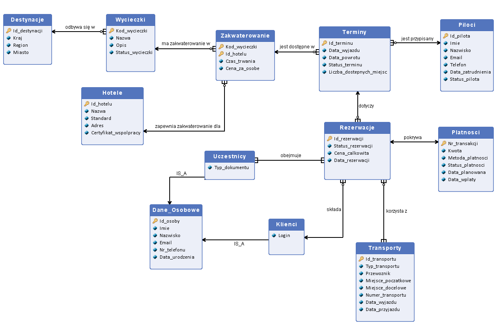

# Travel Agency Database System

Relational database project modeling a travel agency management system using a normalized relational schema. The system includes trips, destinations, hotels, reservations, payments, transport, and tour guides.

---

## Project Overview

The schema supports:

- Destinations (country, region, city)
- Trips and their lifecycle (planned, active, archived)
- Trip terms with availability tracking
- Accommodation variants (trip–hotel combinations)
- Reservations and participants
- Payment monitoring
- Tour guide assignment
- Transport management identified by natural transport numbers

The design focuses on data consistency and referential integrity.

---

## Entity–Relationship Model

The database includes:

- Natural keys where appropriate (e.g., `Kod_wycieczki`, `Numer_transportu`)
- Composite primary key in `Zakwaterowanie` (`Kod_wycieczki`, `Id_hotelu`)
- Associative entities for M:N relationships
- Explicit mandatory and optional participation
- Specialization of personal data (`Dane_Osobowe` → `Klienci`, `Uczestnicy`)

### ERD Diagram

---

## Core Design Decisions

### Composite Primary Key – Accommodation

`Zakwaterowanie` uses a composite primary key: `(Kod_wycieczki, Id_hotelu)` to uniquely identify each trip–hotel combination.

### Natural Key – Transport

`Transporty` uses `Numer_transportu` as a natural primary key.

### Referential Integrity

The implementation includes:

- PRIMARY KEY and FOREIGN KEY constraints
- UNIQUE and NOT NULL constraints
- CHECK constraints for domain validation
- Enumerated status attributes
- Controlled cascading updates and deletes

All relationships are enforced at the database level.

### Controlled Simplifications

- Each trip term references exactly one accommodation variant.
- No pricing history or discount system is implemented.
- City names in transport records are assumed globally unique.
- Seat allocation is not modeled.

---

## Normalization

The schema follows relational normalization principles and avoids partial and transitive dependencies.

---

## Repository Structure

| File | Description |
|------|------------|
| `SQL/create.sql` | Schema definition (DDL) |
| `SQL/insert.sql` | Sample data (DML) |
| `SQL/update_cascade.sql` | Cascade update examples |
| `SQL/delete_cascade.sql` | Cascade delete examples |
| `SQL/zapytania.sql` | Analytical queries |
| `SQL/drop.sql` | Schema cleanup |
| `ERD/analiza.md` | Business analysis |
| `ERD/baza.erdc` | ERD model source file |
| `ERD/diagram_erd.png` | ERD diagram |

---

## Setup

1. Execute `create.sql`
2. Execute `insert.sql`
3. Run queries from `zapytania.sql`

Optional:
- Use cascade scripts for referential behavior testing.
- Use `drop.sql` to remove all objects.

---
Project for the *Database Systems* course (2025/2026) at Gdańsk University of Technology.
